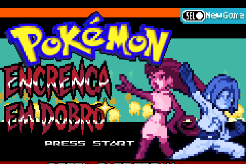
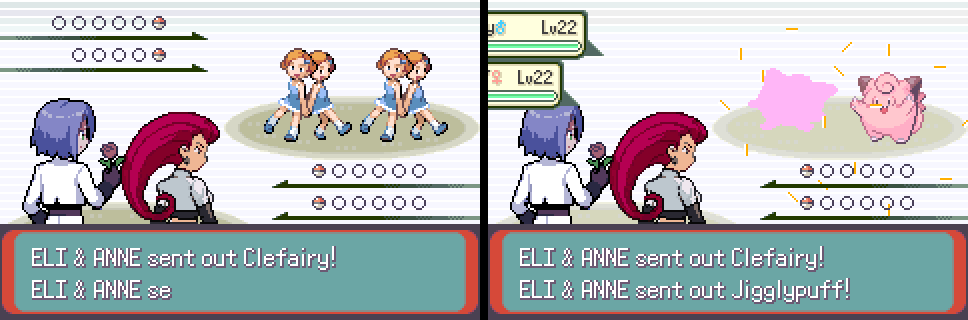

# Pokémon FireRed Duo — Encrenca em Dobro (beta)

**A two-player online Nuzlocke for Pokémon FireRed.** Each player runs their own game on their own PC, and every trainer battle is a co-op double battle against two clones of the trainer.

*(Português mais abaixo.)*

> ⚠️ **Beta.** It's playable from start to finish in what we tested, but expect bugs. If the game crashes, please report what you were doing (map, battle, capture, bike/surf, emote) and a screenshot.

## Features
- **Co-op trainer battles:** when one player meets a trainer, the partner gets an invite and joins. You fight side by side against two clones of the trainer, each with half of its team. The rival brings each player's version of their team.
- **Run modes:** Classic, Soul Link, Hardcore and Casual, plus run rules: first encounter per player or shared, dupes clause, shiny clause, forced nicknames, level cap, battle item limit, EXP share.
- **Randomizer (optional):** wild Pokémon (random or by type), trainers, abilities, starters and gifts.
- **Difficulty:** Vanilla, Hard or Elite trainer teams, with Pokémon from every generation.
- **Play together:** see your partner walking on your map (as a "ghost"), send emotes, trade Pokémon, send items, and see each other on the Town Map.
- **Quality of life:** move relearner in the summary screen (START on the moves page), instant text speed, per-route encounter map, and a GRAVES box for fallen Pokémon.
- **Crash recovery:** the host can roll the run back to both players' last save.
- **Jessie & James** of Team Rocket as the two protagonists.

## What you need
- **Your own ROM** of *Pokémon FireRed (USA, Europe) Rev 1* (`.gba`). The patch only works on that version (not 1.0). **No ROM is provided here.**
- Windows (Linux works too, see the guide in the kit).
- Both players on the same network: [Radmin VPN](https://www.radmin-vpn.com/) is the simplest (Windows); [Tailscale](https://tailscale.com/) works on Windows and Linux.
- The player who hosts needs [Node.js](https://nodejs.org) (LTS) installed to run the server.

## How to play
1. Download **FireRedDuo_Beta_v0.1.zip** from the Releases page and unzip it.
2. Apply `FireRedDuo.bps` to your FireRed Rev 1 ROM with [Rom Patcher JS](https://www.marcrobledo.com/RomPatcher.js/), and save the result as `jogo\FireRedDuo.gba` inside the kit folder.
3. Join the same Radmin/Tailscale network. In `servidor.txt`, both players write **the host's** VPN IP (`127.0.0.1` only works for testing on one PC).
4. The host runs `Hospedar_servidor.bat` and keeps the window open.
5. Both open `Jogar.bat`. In mGBA, go to **Tools > Scripting > File > Load script** and pick `client\duonet.lua`.
6. Start a **New Game**. After Oak's intro, one player creates a room in the **DUO** menu, and the other enters the 6-letter code.

The full step-by-step guide is in the kit: `README_EN.txt` (English) and `LEIA-ME.txt` (Portuguese). The game itself is in English.

## Known issues
- **Rare crashes reported** ("Jumped to invalid address", "OUT OF SPRITE SLOTS"). We could not reproduce them yet. The game saves after every battle and capture; if it crashes, both players close the game and the host runs `Voltar_ultimo_ponto.bat` with the room code.
- **The VS Seeker doesn't work** in this base.
- At the end of a co-op battle, the Win/Loss screen cuts long trainer names to 7 letters.

## Credits
Built on [pokeemerald-expansion](https://github.com/rh-hideout/pokeemerald-expansion) (RHH) and the FireRed decomp. Emulator: [mGBA](https://mgba.io) (bundled portable, under its own license). Pokémon is © Nintendo / Creatures / GAME FREAK. This is a non-commercial fan project.

---

# Português

**Um Nuzlocke online para dois jogadores em Pokémon FireRed.** Cada um joga no seu próprio jogo, no seu PC, e toda batalha contra treinador é uma batalha em dupla contra dois clones do treinador.

> ⚠️ **Beta.** Dá para jogar do começo ao fim no que testamos, mas pode ter bugs. Se travar, conte o que estava fazendo (mapa, batalha, captura, bike/surf, emote) e mande um print.

## O que tem
- **Batalhas co-op contra treinadores:** quem encontra o treinador convida, o parceiro aceita e entra. Vocês lutam lado a lado contra dois clones, cada um com metade do time. O rival vem com a versão do time de cada jogador.
- **Modos:** Clássico, Soul Link, Hardcore e Casual, mais as regras da run: primeiro encontro por jogador ou compartilhado, dupes clause, shiny clause, apelidos obrigatórios, level cap, limite de itens em batalha e EXP share.
- **Randomizer (opcional):** selvagens (aleatório ou por tipo), treinadores, habilidades, iniciais e presentes.
- **Dificuldade:** times Vanilla, Difícil ou Elite, com Pokémon de todas as gerações.
- **Jogar junto:** veja o parceiro andando no seu mapa (o "fantasma"), mande emotes, troque Pokémon, mande itens e veja um ao outro no Town Map.
- **Conforto:** relembrador de golpes no resumo do Pokémon (START na página de golpes), texto instantâneo, mapa de encontros por rota e a caixa GRAVES para os que morreram.
- **Recuperação de crash:** quem hospeda volta a run para o último save dos dois.
- **Jessie e James**, da Equipe Rocket, como protagonistas.

## Do que precisa
- **Sua própria ROM** de *Pokémon FireRed (USA, Europe) Rev 1* (`.gba`). O patch só funciona nessa versão (a 1.0 não serve). **Nenhuma ROM é distribuída aqui.**
- Windows (ou Linux, veja o guia do kit).
- Os dois na mesma rede: a Radmin VPN é o mais simples; o Tailscale funciona no Windows e no Linux.
- Quem hospeda precisa do Node.js (LTS) instalado.

## Como jogar
O passo a passo completo está no `LEIA-ME.txt` dentro do kit (em inglês: `README_EN.txt`). Em resumo:
1. Baixe o **FireRedDuo_Beta_v0.1.zip** em Releases e descompacte.
2. Aplique o `FireRedDuo.bps` na sua ROM pelo Rom Patcher JS e salve como `jogo\FireRedDuo.gba`.
3. No `servidor.txt`, os dois escrevem o IP da VPN de quem hospeda.
4. Quem hospeda abre o `Hospedar_servidor.bat`.
5. Os dois abrem o `Jogar.bat` e carregam o `client\duonet.lua` em Ferramentas > Scripting.
6. Comecem um New Game e criem a sala no menu **DUO**.

## Problemas conhecidos
- **Crashes raros relatados** ("Jumped to invalid address", "OUT OF SPRITE SLOTS"), ainda não reproduzidos. O jogo salva depois de toda batalha e captura; se travar, os dois fecham o jogo e quem hospeda roda o `Voltar_ultimo_ponto.bat` com o código da sala.
- O **VS Seeker não funciona** nesta base.
- No fim de uma batalha co-op, a tela de placar corta nomes longos em 7 letras.
